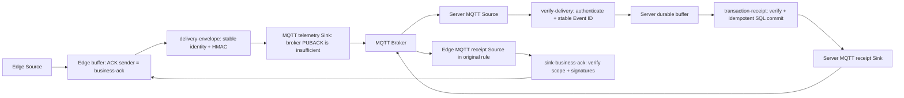

# Application commit receipts, wire protocol v1

The stable SDK already carries scoped AckMessage and designated buffer sender IDs; this design adds independent plugins without changing SDK v1.

Edge buffer retries its original persisted event and stable IDs until an authenticated application receipt reaches its designated ACK Sink. MQTT telemetry Sink may publish its normal broker ACK; the buffer ignores that sender because ack_node_id names the business ACK node. The server buffer separately names its MQTT receipt Sink as designated ACK sender. Both MQTT connections require authenticated topics/ACLs and suitable QoS; HMAC does not encrypt telemetry.

delivery-envelope preserves Event ID/metadata and wraps payload as {delivery,payload}. Delivery identity namespaces origin instance, rule, buffer and persisted record. Payload uses a bounded canonical Go-JSON subset: object/array/string/bool/null, finite safe-precision numbers; large integers must be strings. Purpose-separated HMAC-SHA256 binds header/content hash and commit receipt. Keys are operator-configured per origin/key_id; coordinate rotation and retention before changing keys. Signature ages default7days (configurable up to366days), with30s clock skew; retention and synchronized clocks must match that policy. No secrets are sent or logged.

transaction-receipt verifies envelope before invoking a bound SQL transaction. Parameter paths use delivery.id, delivery.event_id, payload.device_code, payload.data.*, etc. A unique delivery.id constraint plus idempotent INSERT/UPSERT is mandatory. It emits a signed receipt only after ConnectorResponse committed=true. Supported adapters are SQL Server/MySQL/SQLite; no PostgreSQL/TimescaleDB/TDengine transactional claim is added here. Configure least-privilege SQL grants; SQL text is trusted operator code.

sink-business-ack must run in the same edge rule, bind the configured origin/committer/buffer, and be the original buffer's designated ack_node_id. Rule ID is verified against RuntimeContext rather than trusting the incoming message. The buffer additionally validates record/Event ID. A separate ACK Source branch is required; a different ACK rule cannot silently acknowledge another rule.

Failure semantics: broker loss keeps the edge buffer record; server crash before commit emits no receipt; crash after commit/before receipt can replay SQL and requires idempotence; lost receipt causes telemetry replay and a repeated committed receipt; duplicate ACK is harmless for an already removed record. This is at-least-once with business idempotence, not physical exactly-once. Disk exhaustion, signature expiry, wrong rule wiring, malicious trusted committer, key compromise and configuration mistakes remain explicit failure/operational boundaries. Unit tests verify forgery rejection, scope isolation, stable signatures and commit-before-receipt. Dual-engine/broker fault injection and restart/long-run acceptance must be recorded separately.

Server intake must use verify-delivery before persistence: each MQTT receive has a fresh local Event ID, while the authenticated delivery.id remains stable. This stage prevents pending server-buffer amplification during edge retries. The server buffer may add an unsigned top-level event_id for its own transport; that field is explicitly ignored by envelope verification and is never exposed as a SQL parameter identity. The signed original payload/header are unchanged. Completed records may be recreated to regenerate lost receipts; database unique keys remain required.
