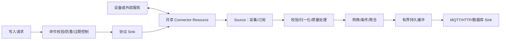

# IoT Rule Plugins 下一阶段开发与升级依据

日期：2026-11-14。本文保留原规划。2026-11-15 用户确认本次包括 M0–M5 全部列出的能力，覆盖下文原有“按需求/可选”的阶段排除；当前实现与生产边界见 [交付台账](PLUGIN_DEVELOPMENT_STATUS.zh-CN.md) 和 [验证记录](DEVELOPMENT_VERIFICATION_2026-11-14.zh-CN.md)。

## 1. 决策摘要

优先顺序建议为：**现有插件可靠性与统一点表 → Modbus → Mitsubishi MC → OPC UA → HTTP 与 SQL Server → 自由口与文件采集 → FANUC → 行业扩展**。同时补充可视化条件路由、校验、限流和窗口聚合，减少用户必须编写 JavaScript 的场景。

Node-RED 的参考价值是节点粒度、配置体验和连接资源复用；本项目继续采用独立插件进程、共享 Connector Resource 和 SDK v1 的稳定边界。Node-RED 配置节点也能够被多个节点引用，不能把“可共享连接”描述为本项目独有能力；实际连接是否共享由具体节点实现决定。S7 节点的 Endpoint 配置就是一个直接参照。[S7 节点说明](https://flows.nodered.org/node/node-red-contrib-s7)

本文的“主流”指常见自动化能力和有代表性的社区节点，**不是经过下载量统计得到的排行榜**。社区节点在维护活跃度、平台、授权和协议覆盖上存在差异；这里只参考功能设计，不直接引入 npm 运行时或承诺兼容 Node-RED flow。

## 2. 已有基线：24 个正式插件，先升级再扩展

以下为本轮开发开始前的 manifest 版本基线；当前未发布补丁与新模块见 [插件目录](PLUGIN_CATALOG.md)，不把本表当作当前发行版本：

| 类别 | 已有插件 ID | 版本 |
|---|---|---|
| Connector，6 个 | connect-mqtt | 1.0.2 |
| | connect-s7、connect-postgres、connect-redis、connect-tdengine、connect-timescaledb | 各 1.0.0 |
| Source，5 个 | source-mqtt | 1.0.1 |
| | source-s7、source-relational-postgres、source-redis、source-timeseries-timescaledb | 各 1.0.0 |
| Processor，7 个 | buffer-node、detect-change、javascript-transform、process-status-event、redis-relationship-mapping、transform、transform-map | 各 1.0.0 |
| Sink，6 个 | sink-mqtt | 1.0.1 |
| | sink-s7、sink-relational-postgres、sink-redis、sink-timeseries-tdengine、sink-timeseries-timescaledb | 各 1.0.0 |

`fanucutil` 及其 stub 不计为已经交付的 FANUC Connector/Source/Sink。有 manifest 也不代表所有真实设备或数据库组合都已验收。

现有 S7、MQTT、Redis、PostgreSQL、TimescaleDB、TDengine 不重复立项。现有 transform、transform-map 和 JavaScript 与后续映射节点有重叠，优先增加配置或改善编辑器；只有职责、输入输出或生命周期明显不同才新增插件。

## 3. Node-RED 对照清单

P0：扩展前必须补齐的基础；P1：下一阶段优先；P2：第二批；P3：有明确设备需求后实施。下列 ID 均为拟定 ID，立项前与 manifest 注册表确认唯一性。

| 编号 | 参考能力 / 代表节点 | 本项目动作 | 优先级与首版边界 |
|---|---|---|---|
| N01 | MQTT in/out | 升级现有 MQTT 三件套及 buffer | P0；稳定客户端身份、可配置持久会话、重连与积压指标；先确定 Broker 接收/业务提交两种交付目标 |
| N02 | S7 in/out/Endpoint | 升级现有 S7 三件套 | P0；点表、分段采集、质量码、100 ms～20 s 生命周期验收；绝对地址访问与符号访问不能混为一谈 |
| N03 | node-red-contrib-modbus | 新增 connect-modbus / source-modbus / sink-modbus | P1；先 TCP，再 RTU/RTU-over-TCP；ASCII 经专项测试后发布；FC1–4、5/6/15/16，单位号和字节序明确 |
| N04 | node-red-contrib-mcprotocol | 新增 connect-mc / source-mc / sink-mc | P1；先确定型号的 3E TCP binary；1E、UDP、ASCII 按各自测试矩阵逐项放开，不笼统宣称全支持 |
| N05 | node-red-contrib-opcua | 新增 connect-opcua / source-opcua / sink-opcua | P1；Browse、Read/Write、数据订阅、证书信任和质量码；事件订阅随后验收，Method Call 后续立项 |
| N06 | HTTP Request / HTTP in/response | connect-http、request-http、source-http-poll；Webhook 接入由 Engine ingress 提供 | P1；受限出站 HTTP、JSON、超时、认证、分页、ETag；HTTP 请求结果继续流向下游，故 request-http 是 Processor |
| N07 | Function | 升级 javascript-transform | P1；输入输出示例、超时、脚本版本、日志配额、受控内置函数；不承诺 Node.js/npm 兼容 |
| N08 | Change / Template | 升级 transform-map；确有缺口再建 render-template | P1/P2；重命名、删除、常量、路径提取、模板转义；JSONata 属单独评估项 |
| N09 | Switch | condition-router，或优先增强现有 Engine 路由 | P1；类型安全比较、默认分支、首匹配/多匹配；错误路由需要引擎配合 |
| N10 | RBE、Range、Smooth | 升级 detect-change；新增 normalize-points、window-aggregate | P1/P2；死区、比例偏移、精度、范围、坏质量策略；均值/min/max/count 等有界窗口 |
| N11 | Delay、Trigger | rate-limit、debounce、trigger-timeout | P1/P2；latest-only 与必须全送语义分开，队列有界，说明重启后是否保留状态 |
| N12 | Split / Join / Batch | split-records、join-records、batch-events | P2；关联键、数量/时间上限、超时输出、迟到与重复策略；避免无限聚合 |
| N13 | Inject / cron-plus | source-schedule；手动触发使用 Manager 的受控测试入口 | P1；时区、cron、定时测试数据、错过周期策略；真实 PLC 的采集时钟仍由 ScanCoordinator 管理 |
| N14 | Catch / Status / Complete / Debug | Engine 状态/错误事件入口 + 有界 debug sink | P0/P1；不可只加一个插件就承诺能捕获所有节点失败；调试默认采样脱敏 |
| N15 | JSON / XML / CSV / Buffer parser | parse-records、decode-binary；与已有 transform 去重 | P1/P2；格式显式、输入大小受限、字节序、BCD、位域、字符编码和大整数策略 |
| N16 | TCP / UDP / Serial | 自由口能力分解为传输 Connector + Source + 编解码 Processor | P2；TCP/串口首发；UDP 独立验证丢包/乱序；一条物理串口由一个资源拥有 |
| N17 | MySQL / MSSQL / SQLite | connect/source/sink-relational-mssql 优先；MySQL、SQLite 按需求跟进 | MSSQL P1，其他 P2；参数化、连接池、增量水位、事务提交后确认；查询结果需流转时使用 request 类 Processor |
| N18 | InfluxDB | connect-influxdb、sink-timeseries-influxdb，查询随后 | P2；版本与 API 能力矩阵明确，不能从社区节点的 1.x/2.x 支持推定覆盖其他版本 |
| N19 | Redis / PostgreSQL 类节点 | 升级现有插件 | P1；参数化查询、查询量上限、池指标、缓存 TTL、写入幂等，不重复新建协议包 |
| N20 | File in/out、watch、SFTP 类节点 | source-file-watch、sink-file；SFTP 后续 | P2；只允许配置目录、稳定写入判定、水位、重复文件和重启恢复 |
| N21 | WebSocket 类节点 | connect-websocket / source-websocket / sink-websocket | P2；持久连接、心跳、帧上限、背压；按实际业务优先于原始 UDP |
| N22 | OMRON FINS / EtherNet/IP | 各自独立 Connector/Source/Sink | P3；先有型号和模拟器/真机再排期；不等于 OPC UA 或 MC 的兼容模式 |
| N23 | Email / webhook notification | request-http 基础上复用 webhook；邮件单独 sink-email | P2/P3；告警节流、去重、凭据、失败回执；不要按每个消息平台创建重复 HTTP Connector |
| N24 | AMQP / Kafka / MongoDB / BACnet / CAN 等生态 | 保留需求池 | P3；有项目需求再做，当前工业 PLC 主链路收益较低或本地无直接实现证据 |

基础节点参照 [Node-RED 核心节点文档](https://nodered.org/docs/user-guide/nodes) 和 [核心节点源码目录](https://github.com/node-red/node-red/tree/main/packages/node_modules/%40node-red/nodes/core)。定时与二进制处理分别参照 [cron-plus](https://flows3.nodered.org/node/node-red-contrib-cron-plus)、[buffer-parser](https://flows.nodered.org/node/node-red-contrib-buffer-parser)。这些节点的能力边界用于对照，不作为本项目已实现能力。

工业协议参照：[Modbus](https://flows.nodered.org/node/node-red-contrib-modbus)、[MC](https://flows.nodered.org/node/node-red-contrib-mcprotocol)、[OPC UA](https://flows.nodered.org/node/node-red-contrib-opcua)。MC 页面列出的帧型/模式有附带限制，应以具体组合验收。数据库与串口参照：[MSSQL](https://flows.nodered.org/node/node-red-contrib-mssql-plus)、[MySQL](https://flows.nodered.org/node/node-red-node-mysql)、[InfluxDB](https://flows.nodered.org/node/node-red-contrib-influxdb)、[Serialport](https://flows.nodered.org/node/node-red-node-serialport)。FINS 和 EtherNet/IP 的代表分别为 [omron-fins](https://flows.nodered.org/node/node-red-contrib-omron-fins)、[cip-ethernet-ip](https://flows.nodered.org/node/node-red-contrib-cip-ethernet-ip)；代表节点可能已较长时间未更新，不能据其存在推定适合直接依赖。

## 4. 本地 edge-apps 可提取能力

以下是 README、go.mod 和关键源码抽查结果，**未运行这些旧应用的测试或连接真机**。有代码和测试文件属于可参考资产，不等于协议已在新引擎验收。内部证据目录和客户变体清单保存在本次本机调研附件，公开文档不携带客户配置或设备地址。

| 应用/类别 | 已观察到的能力 | 迁移目标与方案 | 主要限制 |
|---|---|---|---|
| edge-service-modbus | 地址解析、批量规划、字节序、TCP/RTU/ASCII/RTU-over-TCP 配置路径 | Modbus 三件套；优先迁移纯地址/编解码/批量规划及测试向量，再重写 SDK 适配 | 旧代码依赖 edge-service-sdk；传输模式各自验收，不能复制旧生命周期 |
| edge-service-mc | MC 地址/值编解码、1E/3E 路径、ASCII 和 UDP 专用客户端文件 | MC 三件套；先 3E TCP binary，其他组合分阶段 | 当前观察不足以证明 4E 全覆盖；不继承静默回退到默认帧型的配置行为 |
| MC 客户变体 | 协议之外有关系查询、设备流程和闭环业务 | 协议修正归入 MC；关系映射归现有通用插件；工艺流程成为私有插件或规则模板 | 不为每个客户创建一个官方协议插件，不携带客户表名/点位/工艺参数 |
| edge-service-s7 及客户变体 | 地址/位合并、共享 I/O、两阶段读、操作控制与参数化命令入口 | 升级现有 S7，参考测试补强读写互斥与分段；通用命令按需求独立设计 | “两阶段读”需核对一致性前提，不自动等于 PLC 原子快照；工艺命令不并入通用 Connector |
| edge-service-lsx | 实际 driver 使用 gos7 与 S7 配置/地址模块 | 归入 S7 参考资料和配置迁移，不另建 LS/XGT 插件 | 不能根据目录名字推断为 LS PLC 专用协议支持 |
| edge-service-opcua | gopcua、NodeId 解析、数据订阅、事件订阅及测试文件 | OPC UA 三件套；Browse 工具迁为 Engine 资源配置辅助能力 | 自带 CNC profiles 存在占位或需真机核验的 NodeId；订阅必须保持会话，不套用低频 S7 每批关闭 |
| edge-service-freeport | 串口/TCP、schema 含 poll/stream 但 worker 仅实现 poll、固定长/终止符/长度字段成帧、二进制/正则字段 | connect-serial / connect-tcp、source-freeport、decode-binary；首版只读 | 当前实现显式拒绝通用写入；任意写入需独立编码与协议验收，不宣称现成支持 |
| edge-service-fanuc | FOCAS cgo、状态/报警/程序/刀具、进给倍率、程序管理入口 | connect-fanuc / source-fanuc 优先只读；sink-fanuc 在安全与真机验收后启用 | 目录中可见 x64、armv7 库及头文件，未见 arm64 对应库；声明 arm64 构建路径不等于有可部署包；原生库随包分发先确认许可与来源 |
| edge-service-ezsocket | Windows COM/ActiveX 客户端、其他平台 stub | 保留 Windows 独立服务，通过 MQTT/HTTP 桥接；必要时私有 bridge 插件 | 不纳入 Linux arm64/amd64 原生插件交付，不直接把 COM DLL 放到 Linux 包 |
| edge-service-lsv2 | 纯 Go 帧编解码、登录级别、只读与倍率写保护 | connect-lsv2 / source-lsv2 后续；写入单独发布 | README 明示部分子码/倍率编码需抓包及真机验证；不是已验证通用 CNC 驱动 |
| edge-service-zzele | IEC 60870-5-104、点表、总召、链路和报文测试 | 通用命名 connect-iec104 / source-iec104 | 当前电表实现只读，不能把写入、遥控或任意设备支持算作已具备 |
| edge-service-db | SQL Server、XML 目录、文本文件驱动，HTTP/MQTT 上报 | MSSQL 三件套 + file-watch + parse-records；上报复用现有 MQTT/HTTP | 旧 SQL Server 兼容驱动与旧 TLS 特性不直接作为新插件默认；须按服务端版本评估 |
| edge-service-spectrum | 文件监控、XML 解析、SQLite 状态/进度、业务字段映射 | 提取通用文件监控、格式解析、断点/去重；行业转换私有化或规则化 | 不创建包含具体 MES 字段的通用 spectrum 插件 |
| edge-service-sidecar | MQTT 输入、每流程 inbox、事务分发、outbox、TTL、ACK 关联 | 参考升级 buffer、command-guard 及应用回执设计 | 不能整套拷贝到现有 NATS/调度器；不同实例间的业务回执必须有稳定 ID 与持久状态 |
| edge-collector | 自由口组合运行与测试用例 | 迁为自由口端到端规则示例和模拟设备测试 | 独立应用外壳不需要成为插件 |
| edge-casting / edge-conveyor / ASRS / edge-tesla 与业务包 | 工艺、调度、WMS 接口、关系查询、时序曲线、通知和状态指标 | 提取 request-http、映射、outbox、状态派生的通用需求；业务留在应用/私有规则 | 完整 WMS、AI 调度、看板和工艺控制不放进通用协议插件 |
| edge-service-xray / edge-asrs-ai | 本次观察为模块或空目录级占位 | 需求池，先补需求与协议说明 | 不计为可迁移实现；与 casting 中存在 X-ray 相关采集文件是不同证据 |

## 5. 统一设计约束

### 5.1 插件职责与部署



- 一个正式插件一个目录、go.mod、manifest 和可执行产物；沿用现有独立进程机制。一个 artifact 对应一个进程，多条规则创建不同插件实例，不按规则重复启动进程。
- 连接、订阅、设备串行化和物理会话归 Connector；采集时间与点表归 Source/协调器；写入归 Sink；数据转换归 Processor。请求后需要返回数据继续处理的节点归 Processor。
- 不引入插件间 implementation import，也不把设备协议库或业务流程塞入 SDK。仅在 SDK 出现真正通用契约需求时评估可选扩展，保持 v1 三年兼容承诺。
- MC/S7 按需求复用；OPC UA Subscription、MQTT 与串口流必须按持续需求持有；数据库是有界连接池。连接资源在同一 Engine 实例共享，跨网关不共享进程或 TCP 会话。
- Modbus RTU 的一个 Connector Resource 代表一条物理总线，多 slave/unit ID 在同一串行门禁内调度；不能为每个 slave 各开串口。TCP 端点和多 unit ID 也必须明确资源归属。
- 多个配置 Resource 指向同一设备仍可能多开连接；需要 Engine 的物理地址冲突检查/共享键策略，不能承诺不同 Resource 自动合并。

### 5.2 点表和事件：配置统一，协议地址保留差异

采用版本化 JSON profile，Excel 仅作为导入/导出格式。字段至少含 name、address、valueType、readWrite、intervalMillis、byteOrder、scale、offset、precision、min/max、outOfRangePolicy、defaultValue。OPC UA 应保留 NodeId/namespace URI，Modbus 应明确地址是协议 0-based offset 还是人工 4xxxx 表示，不允许含糊转换。大整数、NaN/Inf、编码、时间和时区都必须有策略。

建议流水线：原始解码 → scale/offset → 范围判定 → 精度处理 → 业务输出；顺序写入规范。默认替代值只用于显示/业务策略，不得把坏质量变成 good。profile schema 各插件独立包含，通过一致性测试防止漂移；Engine 提供统一点表编辑和 Excel 工具，不让每个协议重建一套 UI。

对外遥测继续兼容：

```json
{"device_code":"machine-001","data":{"temperature":26.35},"time":1794614400000}
```

内部事件应额外保留 event_id、trace_id、sourceTime、receiveTime、逐点质量/错误与协议来源；映射到现有 SDK Event 字段及 Payload 的可选命名空间，不改变 SDK v1 字段定义，也不随意塞入调度 Metadata。默认只在外发映射中输出上述三字段格式。部分点失败时保留逐点质量，不把零值伪装为采集成功。

### 5.3 读写、可靠性和应用回执

所有协议配置超时、取消、队列上限和退避。高频采集 latest-only，不追补过期 Tick；单批次分段共用设备会话；写入在批次边界公平调度。除非协议和命令明确幂等，写入不透明重试。

拟定 `command-guard` 的输入为 command_id、target、expires_at、operation、arguments；输出为获准命令或结构化拒绝结果。去重记录及结果需持久化并绑定规则/设备作用域。guard 加 PLC Sink 不能自动实现物理动作 exactly-once：动作执行后、结果持久化前发生故障时应返回“结果未知”，通过设备状态查询或人工处理恢复，禁止盲目重做。

MQTT/HTTP 接收、业务库事务提交、设备实际完成分别定义不同确认级别。真正的业务落库回执需服务器数据库 Sink/回执节点、MQTT ACK topic、边缘 ACK Source 和持久 buffer 共同升级；这涉及 Engine 路由和状态恢复，不能只改 MQTT Sink 就宣称端到端可靠。具体 ACK 接线方式和 SDK v1 可表达性先做设计验证。

### 5.4 Engine 和 Hub 的配套工作

Engine：协议能力描述、点表编辑/Excel、OPC UA Browse 辅助入口、错误/状态事件、手动触发、路由分支、Connector 配置代际、secret 引用及依赖版本校验。HTTP webhook 需统一鉴权、路由注册与取消、限流和响应生命周期；不由每条规则自行监听端口。SQL 参数化、出站地址限制和文件目录边界由具体插件执行，Engine 提供配置策略入口。

Hub：插件按需安装、OS/架构/原生依赖过滤、签名/摘要/SBOM、私有可见性和发布者授权。可选新增描述信息必须版本化并向后兼容；当前 manifest 不识别的字段不得直接当作 Engine 已执行的安装限制。厂商原生库缺失时明确不可安装，不以 stub 冒充可用设备支持。

## 6. 去重后的阶段计划与开发票据

| 阶段 | 交付 | 验收与进入下一阶段条件 |
|---|---|---|
| M0，基础升级 | 既有 S7/MQTT/buffer，点表规范、质量语义、命令/回执设计验证，能力矩阵 | 明确消息确认边界；共享进程和资源生命周期回归；点表合法性、坏质量、大整数测试 |
| M1，首批新协议 | Modbus 三件套 + MC 三件套；校验/归一化和可视化路由优先增强既有节点 | 每协议一个模拟器闭环及一个已记录型号的真机只读验收；写入需测试区许可；首发组合明确 |
| M2，集成覆盖 | OPC UA 三件套，HTTP request/poll，共享 MSSQL 连接/采集/写入 | 证书、订阅重建、参数化 SQL、水位重启、连接共用和跨规则隔离通过 |
| M3，采集泛化 | 自由口/文件监控/格式解析、限流、窗口/批处理、定时 | 串口独占、成帧异常、重复文件、聚合上限、时区和重启行为可验证 |
| M4，专用设备 | FANUC 只读，然后受控写入；IEC104、LSV2；EZSocket 桥接 | 明确原生库、CPU 架构和平台；每能力有真机证据，未知结果可恢复 |
| M5，按需求 | MySQL/SQLite/InfluxDB、WebSocket、FINS、EtherNet/IP 等 | 有明确需求、样机和协议测试基线再扩展；不按生态节点数量追求全部覆盖 |

建议首轮建立以下开发票据，每票据必须含 schema、事件样例、错误语义和测试矩阵：

1. PLG-001：协议能力矩阵与统一 profile v1；包括质量、精度和范围处理顺序。
2. PLG-002：现有 S7/MQTT/buffer 可靠性升级和业务回执设计验证。
3. PLG-003：Modbus TCP 三件套；FC/地址/字节序/异常响应测试。
4. PLG-004：Modbus RTU 与 RTU-over-TCP；总线独占及多 slave 公平性。
5. PLG-005：MC 3E TCP binary 三件套；1E/ASCII/UDP 作为后续子票据。
6. PLG-006：OPC UA Read/Write/Browse，再做 Subscription/事件恢复。
7. PLG-007：HTTP Connector + Request/Poll + Engine webhook 设计。
8. PLG-008：SQL Server Connector + 查询/增量采集/写入；现代安全配置优先。
9. PLG-009：自由口成帧/二进制编解码与文件采集，区分旧服务只读限制。
10. PLG-010：FANUC 原生库和支持平台 PoC；独立作出 arm64 能否交付的结论。
11. PLG-011：sidecar inbox/outbox、TTL/ACK 的可迁移性与 command-guard 设计。
12. PLG-012：模板、条件、限流、窗口节点与 UI 参数编辑，先检查现有节点重叠。

阶段按依赖推进，不同时启动所有协议；不在缺少人员/设备信息时承诺固定日期。新插件首版 1.0.0；已有插件按实际兼容性递增版本，发布集合版本与单插件版本分离。

## 7. 通用交付验收

- 单插件独立 `GOWORK=off` build/test/race/vet；无其他插件 implementation import，无本地 replace。
- Linux amd64/arm64 分别构建并至少在对应运行环境验证；依赖原生库的插件单独列 CGO、系统库及厂商库矩阵。armv7 为单独可选目标。
- 同一插件的 20 条规则共享一个进程；同一 Connector 多 Source/Sink 共用资源；停止一条规则不影响其他规则。
- 单资源串行性、读写公平性、超时取消、离线退避、停止释放、配置变更、安全边界可验证。
- 100/500 ms、5/20 s 四组采集，记录周期/排队/分段/连接次数、p50/p95/p99、丢弃和坏质量；目标由设备实测确定，不承诺所有设备达到 100 ms。
- 持久链路覆盖进程强杀、Broker/服务端离线、重放去重、磁盘满、慢 Sink、重启恢复；72 小时长稳作为生产放行项，不用短单元测试替代。
- 每插件交付 manifest、完整输入输出、配置 schema、示例 profile/规则、模拟器、支持与不支持清单、升级/回滚说明、签名和 SBOM。

## 8. 本次调研边界

Node-RED 信息取自官方文档、核心仓库及节点维护者页面，访问日期 2026-11-14。包版本和维护状态会变化，因此这里不锁定社区 npm 版本，也不等价承诺功能兼容。本地调研只读，未改 edge-apps，未执行真实 PLC 写入或将客户配置复制进公开仓库。本文是下一阶段立项依据，不是旧应用测试报告或所有插件已实现证明。
